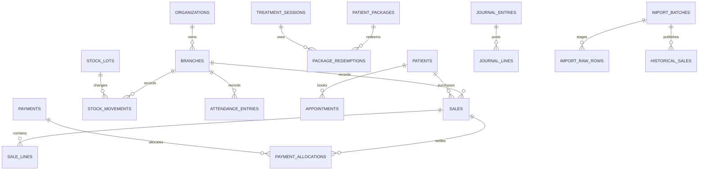

# HERMOSA OS — Logical Database Schema v1.0

**Production target:** PostgreSQL. The executable starter migration in `db/migrations/0001_foundation_and_history.sql` implements ONLY foundation, access, historical sales staging/signoff and audit. Below is the wider normalized **target schema**, to be implemented in small transactional migrations as modules are delivered. It is a design, not a claim that all tables below are already migrated.

## Modeling conventions

- Primary key UUID for all transaction entities. `organization_id` required for multi-tenant safety; operational rows require `branch_id` except explicitly company-scoped masters and global people.
- `branch_id` vs `cost_center_id` separate when staff can work in another branch or HQ incurs centrally allocated costs.
- External source IDs unique within `source_system`; events have `idempotency_key` and appropriate `UNIQUE` scopes. Use FK constraints on every reference.
- Money `NUMERIC(18,2)`, noncurrency quantities `NUMERIC(18,4)`; never floating-point money. `posted_at` UTC, `effective_on` branch-local `DATE` and explicit reporting basis.
- Avoid deleting posted documents; use `reversal_of_id`, status transitions, versioned effective dates and append-only audit.
- Financial journal lines must balance per journal entry, currency and company; **database trigger or posting stored procedure** locks the entry and enforces the invariant atomically. The draft base DDL alone is not final financial posting.
- `patient_clinical_*` tables live in restricted schema / separately permissioned file objects; clinic administrative roles must never query clinical content through shared views.

## Entity/domain inventory

| Area | Tables and representative key columns | Critical links/invariants |
|---|---|---|
| Organization | `organizations(id)`, `branches(id, organization_id, code, kind, timezone)`, `cost_centers(id, branch_id, code)` | Unique organization + branch code; HQ cost center not external sales branch |
| Access | `app_users(id, auth_subject)`, `roles(code)`, `user_role_grants(user_id, role, branch_id)`, `approval_requests(target_type, target_id, initiator_id, approver_id, state)` | Branch-scoped permission; four-eye approval; privileged roles MFA |
| Governance | `audit_events(actor, action, resource, before_json, after_json)`, `period_locks(branch, scope, start/end, locked_by)`, `files(object_key, checksum, consent_id)` | Append-only audit; no edits to locked periods; signed private file URLs |
| Patient CRM | `patients(id, dedupe_fingerprint)`, `patient_contact_methods`, `patient_consents(patient_id, scope, version, granted_at, revoked_at)`, `patient_merge_events` | Global patient ID, minimal PII, versioned lawful consent; soft merge |
| Inquiry | `leads(id, branch_id, patient_id, campaign_id, source)`, `lead_events(lead_id, action, occurred_at)`, `followup_tasks`, `campaigns` | Unknown source preserved; lead-to-appointment and attributed revenue reproducible |
| Booking | `appointments(id, branch_id, patient_id, service_id, assignee_id, status, start_at)`, `appointment_events` | Chronological status audit; walk-in distinct from booked; no unsupported conflict-free promise |
| Catalog | `services`, `service_price_versions(service_id, branch_id, effective_from, price)`, `promotion_rules`, `commission_rule_versions`, `service_material_boms` | No overlapping effective windows; preserve historical price/commission versions |
| POS | `sales(id, branch_id, patient_id, posting_date, status, total)`, `sale_lines`, `payments`, `payment_allocations`, `refunds`, `cashier_shifts`, `cash_closures` | Sales and collections separate; split/partial payments; refund links reverse posting |
| Package liability | `package_plans`, `patient_packages(patient_id, branch_id, purchased_sale_line_id, liability_balance)`, `package_entitlements`, `package_redemptions` | 5+1 has 6 units; atomic redeem unique session; no negative units; recognized revenue released only per approved policy |
| Clinical operations | `treatment_sessions(id, branch_id, patient_id, appointment_id, performed_by, status)`, `clinical_protocol_versions`, `clinical_consents`, `clinical_incidents`, `clinical_photo_assets` | Clinical schema privilege; photo access tied to purpose-specific consent and audit |
| Stock | `items`, `units`, `stock_locations`, `stock_lots(item_id, branch_id, batch_no, expiry_on)`, `stock_movements(quantity_delta, lot_id, reason, origin_ref)`, `stock_counts` | Exact branch + lot + location; immutable movements; never below allowed available stock |
| Transfers | `stock_transfer_headers(from_branch_id, to_branch_id, state)`, `stock_transfer_lines`, `stock_transfer_receipts` | Send/receipt each idempotent, in-transit visible, whole-company stock conserved |
| Suppliers | `suppliers`, `supplier_price_versions`, `purchase_requests`, `purchase_orders`, `purchase_order_lines`, `goods_receipts`, `goods_receipt_lines`, `supplier_bills`, `supplier_payments` | Three-way matching and duplicate invoice protection; partial deliveries |
| Finance | `chart_of_accounts`, `journal_entries(organization, branch, posted_date, state)`, `journal_lines(entry_id, account_id, debit, credit, cost_center_id)`, `expenses`, `expense_allocations`, `petty_cash_entries`, `fixed_assets`, `prepayment_schedules`, `reconciliation_events` | Per-journal balanced debits/credits; internal eliminations; HQ allocations not new money |
| HR | `employees(id, home_branch_id)`, `employment_contract_versions`, `work_shifts`, `time_punches`, `attendance_entries(actual_branch_id, approved_by)`, `leave_entries`, `compensation_rate_versions` | Actual worked branch on each entry, not just home branch; payroll cutoff and exceptions |
| Payroll | `payroll_rule_versions`, `statutory_rate_versions(type, source_url, effective_from, approved_by)`, `payroll_runs(cutoff, approval_status)`, `payroll_earnings`, `payroll_deductions`, `payroll_payments`, `payslip_documents`, `employee_advance_ledger` | Effective rules, separated gross/deductions/employer costs, no run approval with unresolved exceptions |
| Marketing | `ad_accounts`, `ad_campaigns`, `ad_spend_daily(date, branch, campaign, value, source_row)`, `marketing_attributions`, `meta_sync_runs` | Unique provider event IDs, approved branch allocation, unknown attribution flagged |
| Import | `import_batches(source_file_hash, branch_id, mapping_version, state)`, `import_raw_rows(payload, errors)`, `historical_sales(source_key, amount, branch_id, import_batch_id)`, `import_reconciliation_signoffs` | Post only reconciled batches; raw rows immutable; unique source IDs prevent duplicates |
| Reporting | `metric_definitions`, `reporting_snapshots`, `report_export_jobs` | Materialized views recalculated after reversals; disclose basis/completeness/date |

## Suggested normalized relationships

## High-risk queries requiring explicit security tests

- Owners may see consolidated **finance** but are NOT assumed permitted to see all medical records. Clinician photo retrieval requires recorded consent purpose and patient-care authorization.
- Reports run under the user's authorized branch scopes at query time, including downloads. No endpoint accepts arbitrary branch IDs without backend guard.
- HR and payroll are never returned to cashiers, marketing or standard branch manager roles at employee-level.
- System administrators should be separate from finance posting operators; raw SQL superusers must not be part of web runtime.

## Source separation in reports

- **Validated historical detail:** reconciled actual source transactions, individually traceable.
- **Validated historical summary:** branch/month aggregate from legacy totals with no asserted patient-level or campaign-level links; never masquerade as detailed POS items.
- **Pending imported data:** not included in verified KPI totals.
- **Live operational transactions:** posted in new system, clearly cut over from historical imports to prevent overlaps.

## Migration and data retention design

- Every table migration must be applied in stage then prod, tracked by version and checksum; schema rollback documented or tested restore path.
- Reconciliation signoff needs source filename, SHA-256, expected sales/collections/count, exact actual values, reviewer identity and timestamp.
- Retention/destruction procedures to be reviewed under applicable Philippine privacy rules; don't invent statutory retention periods; use legal holds and secure deletion procedures for eligible data.
